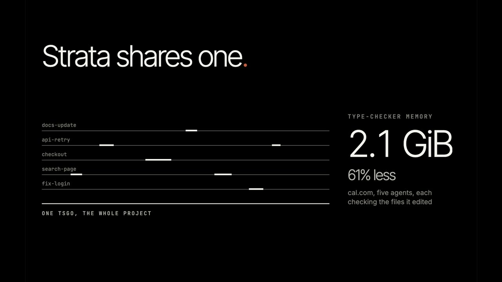
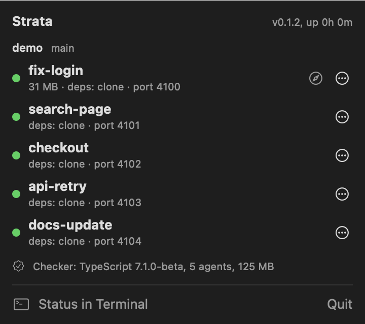

# Strata

Strata is a local runtime for running several coding agents on one TypeScript repo at once. Each agent gets its own git worktree, and Strata makes the expensive parts shared or cheap:

- **One type checker for every worktree.** A single `tsgo` (TypeScript 7.1) holds the base program, and each agent's changes are layered on top of it. With five agents on excalidraw and cal.com it used 20–30% less memory than five separate checkers when every agent checked the whole project, and 60–65% less when each checked the files it edited (`NOTES.md`, Gate 2). Agents ask it through MCP: diagnostics, hover, definition, references, symbols.
- **Dependencies by copy-on-write clone.** `strata new` clones `node_modules` (and any other ignored folders you list) from a worktree that has the same lockfile and manifests. On cal.com that takes about 5–8 s, against a fresh install; with the warm pool, under 1 s.
- **Dev servers with their own URL, budget and cleanup.** `strata dev <agent>` starts the agent's dev server on its own port behind `http://<agent>.<app>.localhost:7355`, hot reload included. Memory per agent is metered against a budget, and `strata rm` leaves no process or port behind.

It is one binary: CLI, daemon and MCP server.

> Status: v0.1.1, the first release (2026-11-03).

## Requirements

- macOS (Apple silicon) or Linux (x86_64, arm64)
- git 2.36 or later
- Node.js 20 or later (the shared checker runs `tsgo` through Node)
- For the shared checker: the repo's own TypeScript 7.1 or later in `node_modules`. Without it, worktrees, seeding, dev servers and budgets still work.
- For fast seeding: a filesystem with clones (APFS; btrfs, XFS with `reflink=1` or OpenZFS 2.2+ on Linux). Elsewhere (ext4) each new worktree installs its dependencies instead.

On a machine that has neither git nor Node yet:

macOS (git comes with the Command Line Tools; Node from Homebrew):

```bash
xcode-select --install
```

```bash
brew install node
```

Ubuntu (Node 22 from NodeSource, since Ubuntu's own `nodejs` is older than 20):

```bash
sudo apt-get update && sudo apt-get install -y git curl xz-utils
```

```bash
curl -fsSL https://deb.nodesource.com/setup_22.x | sudo -E bash - && sudo apt-get install -y nodejs
```

To use the shared checker, the repo needs TypeScript 7.1:

```bash
npm install --save-dev typescript@7.1.0-beta
```

## Install

```bash
brew install c01-dev/tap/strata
```

```bash
npm install -g stratagents
```

```bash
curl --proto '=https' --tlsv1.2 -LsSf https://github.com/C01-Dev/strata/releases/latest/download/strata-installer.sh | sh
```

From source (Rust 1.99):

```bash
cargo install --locked --path crates/strata
```

## Quickstart

In your repo:

```bash
strata init
```

This writes `strata.toml`, installs a per-user service (launchd on macOS, a systemd user unit on Linux) that runs the daemon, and creates Strata's base worktree next to your repo in `../.strata/<repo>/` (for a repo directly in your home folder, `~/.strata/worktrees/<repo>/`, apart from Strata's own files). `strata init --no-service` starts the daemon directly instead.

```bash
strata doctor
```

Checks everything Strata depends on (git, Node, clones, the proxy port, `.localhost`, cgroups on Linux) and says how to fix what is missing.

Give an agent a worktree:

```bash
strata new fix-login
```

That prints the worktree's path on stdout (status goes to stderr), so `cd "$(strata new fix-login)"` works. It has its own branch `fix-login`, its dependencies, and a port. Point the agent at it, with Strata's MCP server configured (see [Recipes](#recipes)).

```bash
strata dev fix-login
```

Starts its dev server and prints `http://fix-login.<app>.localhost:7355` plus the direct `http://localhost:<port>`.

```bash
strata status
```

Shows every agent: state, branch, port, how its dependencies got there, memory, URL, running processes, and the shared checker.

```bash
strata rm fix-login
```

Stops its processes, removes the worktree and deletes the branch if it is merged. It refuses if there are uncommitted changes (`--force` discards them).

## Commands

| Command | What it does |
| --- | --- |
| `strata init [--no-service]` | Write `strata.toml`, start the daemon, create the base worktree |
| `strata new <name> [--from <ref>] [--branch <b>]` | Create a locked worktree with its dependencies and port; print its path |
| `strata adopt <path>` | Register a worktree another tool created |
| `strata rm <name or path> [--force] [--keep-branch]` | Stop the agent's processes and remove its worktree (`.` inside a worktree means that one) |
| `strata check <name> [file] [--json]` | Diagnostics from the shared checker for one file or the whole project |
| `strata dev <name> [--cmd <command>]` | Start the agent's dev server; print its URLs |
| `strata run <name> [--timeout <s>] -- <command>` | Run a command in the worktree under supervision; exits with its code |
| `strata stop <name> [process]` | Stop the agent's running processes (or one), with everything they started |
| `strata logs <name> [process] [--lines <n>]` | The end of a process's output |
| `strata status [--json \| --watch]` | Repos, agents, processes, checker; `--watch` redraws every 2 s |
| `strata doctor [--report]` | Check the setup; `--report` prints a redacted summary to paste into an issue |
| `strata gc` | Remove what nothing uses any more: orphaned agents, stale donors, leftovers, trash, old logs |
| `strata mcp [--agent <name>]` | The MCP server for an agent, on stdio |
| `strata daemon start\|stop\|status\|install\|uninstall` | Manage the daemon and its service |
| `strata bench <fixture>` | The memory benchmark (see [Benchmarks](#benchmarks)) |

## The 18-second version

[](https://strata.c01.dev/#film-title)

## Menu bar app (macOS)



`apps/macos` is a small menu bar app over the same commands. The icon shows how many agents are running, and a crossed-out icon means the daemon is down. Click it to see each agent's state, memory, how its dependencies got there, its port and dev-server URL, and the shared checker. Each agent has actions to start or stop its dev server, open it in Terminal or Finder, copy its path, and remove it. It asks first, and asks again before discarding uncommitted changes. "Status in Terminal" opens `strata status --watch`.

It runs the `strata` CLI, so it needs Strata installed (it looks in `~/.cargo/bin`, `/opt/homebrew/bin`, `/usr/local/bin` and `~/.local/bin`, or `STRATA_BIN`). macOS 14 or later. Until releases ship it, build it yourself:

```bash
apps/macos/bundle.sh && open apps/macos/build/Strata.app
```

## MCP tools

`strata mcp` serves these to the agent whose worktree it runs in. It finds the agent from the MCP client's roots, then its working directory, then `--agent` or `STRATA_AGENT`. Paths are relative to that worktree.

| Tool | Arguments | Returns |
| --- | --- | --- |
| `strata_diagnostics` | `file` (optional) | Errors and warnings with file, line, column, code, message |
| `strata_hover` | `file`, `line`, `column` | Type and documentation of the symbol |
| `strata_definition` | `file`, `line`, `column` | Where it is declared |
| `strata_references` | `file`, `line`, `column` | Every reference |
| `strata_symbols` | `file` | Outline of the file's declarations |
| `strata_start_dev_server` | `command` (optional) | URL, direct URL and process id, at once |
| `strata_run` | `command`, `timeout_s` (optional) | Exit code and the last 200 lines |
| `strata_stop` | `process_id` | Stops one of the agent's processes |
| `strata_logs` | `process_id`, `lines` (optional) | The end of its output |
| `strata_status` | | The agent's worktree, port, memory, processes and checker state |

An agent can only stop or read its own processes. Every answer carries a warning when the agent is near or over its memory budget.

## Recipes

### Claude Code

MCP: add `.mcp.json` to the repo (or run `claude mcp add --transport stdio --scope project strata -- strata mcp`):

```json
{ "mcpServers": { "strata": { "command": "strata", "args": ["mcp"] } } }
```

Worktrees: Claude Code's `WorktreeCreate` and `WorktreeRemove` hooks replace its own git logic, so `claude --worktree` gets a Strata worktree. Put this in `.claude/settings.json` (needs `jq`):

```json
{
  "hooks": {
    "WorktreeCreate": [
      { "hooks": [{ "type": "command", "command": "bash -c 'IN=$(cat); cd \"$(jq -r .cwd <<<\"$IN\")\" && strata new \"$(jq -r .name <<<\"$IN\")\"'" }] }
    ],
    "WorktreeRemove": [
      { "hooks": [{ "type": "command", "command": "bash -c 'P=$(jq -r .worktree_path); cd \"$P\" && strata rm .'" }] }
    ]
  }
}
```

The create hook must print the worktree's absolute path as the last line of stdout, which `strata new` does. Removal refuses a worktree with uncommitted changes, so nothing is discarded silently; configure both hooks, since Claude Code's own fallback (`git worktree remove`) cannot remove Strata's locked worktrees.

### Codex

In `~/.codex/config.toml`, or a trusted project's `.codex/config.toml` (or `codex mcp add strata -- strata mcp`):

```toml
[mcp_servers.strata]
command = "strata"
args = ["mcp"]
```

Then start Codex inside the agent's worktree: `cd "$(strata new fix-login)" && codex`.

### Cursor

`.cursor/mcp.json` in the repo:

```json
{ "mcpServers": { "strata": { "command": "strata", "args": ["mcp"] } } }
```

Open the agent's worktree (`strata new fix-login` prints its path) as the Cursor window's folder.

### Conductor

Conductor creates its own worktrees; Strata adopts them. In `.conductor/settings.toml`:

```toml
[scripts]
setup = "strata adopt ."
archive = "strata rm . --force --keep-branch"
```

Adopted worktrees keep the dependencies Conductor gave them. Add the MCP server in the agent's own configuration (Claude Code or Codex, above).

## Configuration

`strata init` writes `strata.toml` in the repo root. Every key is optional:

```toml
[repo]
base = "main"                     # branch Strata's base worktree follows
worktree_dir = "../.strata/myapp" # where agent worktrees live

[seed]
paths = ["**/node_modules"]       # ignored folders (or files) cloned from a donor; `*` = one folder, `**` = any depth
fallback = "install"              # when cloning fails: install | copy | hardlink
warm_pool = 1                     # worktrees kept seeded ahead of time (0 turns it off)

[checker]
typescript = "auto"               # the repo's own TypeScript; must be 7.1 or later
tsconfig = ["tsconfig.json"]
idle_dispose_secs = 900           # free an idle agent's snapshot after this
huge_diff_ratio = 0.2             # above this share of changed files, the agent gets its own checker program
group_memory_mb = 6144            # above this, dispose the least recently used snapshots
extra_paths = []                  # per-worktree files under node_modules to layer (e.g. "node_modules/.prisma")

[dev]
command = "pnpm dev"              # default: the package manager's `dev` script
port_env = "PORT"
restart = false                   # restart dev servers after a reboot
port_range = [4100, 4999]
proxy_port = 7355
app = "myapp"                     # gives <agent>.myapp.localhost

[budget]
per_agent_mb = 4096
action = "warn"                   # warn | stop (stops the agent's processes, keeps the agent)
```

Notes:

- **Seeding.** A worktree gets its dependencies from a *donor*: Strata's base worktree, or any worktree that installed with the same lockfiles, `package.json` files, package-manager config, `patches/` and Node ABI. List generated files your tests need under `seed.paths` (cal.com: `packages/prisma/generated`, `packages/prisma/zod`, ...). `strata new` prints which tier it got: `clone`, `copy`, `hardlink` (files shared with the donor), `install`, or `shared store, not isolated` for pnpm's global virtual store, which is installed rather than cloned.
- **Dev server presets.** When the dev command is the project's own `dev` script: Next.js gets `PORT`, Vite `--port N --strictPort`, Astro `--port N`; anything else gets `PORT`, and Strata routes to wherever it really listens.
- **The checker** needs TypeScript 7.1 (`tsgo`); with an older TypeScript, Yarn Plug'n'Play or none, `strata init` says so and the rest works.

## Platform notes

- **macOS:** clones are one `clonefile(2)` per folder. Processes are tracked by process group and recorded descendants; memory is `phys_footprint`.
- **Linux:** clones are reflinks, file by file, in parallel. On ext4 the `seed.fallback` tier runs. Run the daemon as the systemd user service (`strata init` installs it with `Delegate=yes`) to give each agent its own cgroup; without one, processes are tracked by parent pid and memory by PSS. `strata doctor` shows inotify usage: several dev servers' file watchers can run out of `fs.inotify.max_user_watches` before memory.
- **`.localhost`:** browsers resolve `*.localhost` themselves. For curl or scripts on a system that does not, use the direct `http://localhost:<port>` URL that `strata dev` prints.
- **Socket path:** the daemon listens on `$STRATA_HOME/strata.sock` (default `~/.strata`); a path over 103 bytes cannot be a Unix socket, so keep `STRATA_HOME` short.

## Benchmarks

`bench/` reproduces the measurements in `NOTES.md` on pinned open-source fixtures (excalidraw, cal.com):

```bash
bench/setup.sh
```

```bash
strata bench bench/fixtures/calcom --tsconfig apps/web/tsconfig.json
```

`bench/phase0.sh` is the original Node harness; `bench/soak.sh` runs five agents for hours and reports memory growth. Results land in `bench/results/`.

## Troubleshooting

Run `strata doctor` first. When filing an issue, include `strata doctor --report`; it replaces your home folder, user name and repo paths with placeholders. Daemon logs are in `~/.strata/logs/`.

## Development

New here, or on Windows? [CONTRIBUTING.md](CONTRIBUTING.md) sets you up in one command (`scripts/dev-setup.sh`, also under WSL2) and shows how to send a change.

```bash
cargo test
```

The end-to-end tests make temporary repos and daemons; four heavy ones are ignored by default (`cargo test -p strata --test nextjs -- --ignored` runs five Next.js dev servers; the parity runs on excalidraw and cal.com need `bench/setup.sh`). `NOTES.md` is the log of decisions and measured numbers; `PLAN.md` is the plan they follow.

### Releasing

Releases are built by [cargo-dist](https://opensource.axo.dev/cargo-dist/) on a `v*` tag (`.github/workflows/release.yml`): binaries for macOS arm64 and Linux x86_64/arm64, a shell installer, a Homebrew formula pushed to the tap, and the npm packages (`npm/build.mjs`, published by `.github/workflows/publish-npm.yml`). Before the first release, add the `HOMEBREW_TAP_TOKEN` and `NPM_TOKEN` secrets to the repo. After `dist generate`, re-apply the one-line fix noted in `dist-workspace.toml`.

## License

Strata is made by [C01 Developments](https://c01.dev) and licensed under either of [MIT](LICENSE-MIT) or [Apache-2.0](LICENSE-APACHE), at your option.
